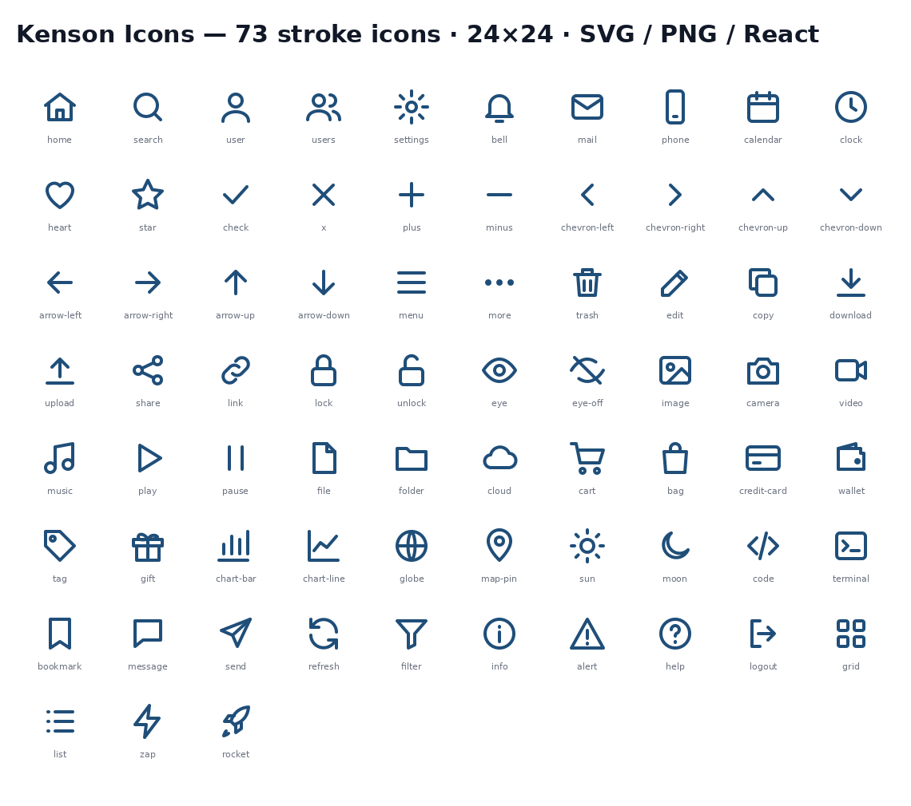

# Kenson Icons — 73 stroke SVG icons (MIT)

A small, consistent set of 73 hand-coded line icons for web and app UIs: 24×24 grid, 2px stroke, round caps and joins, `currentColor` so they inherit your text color. Raw SVG, PNG (32/64/128) and typed React components are included.



## Why

Many icon sets are huge or inconsistent. This one is tiny, uniform, dependency-free and easy to copy into any project.

## Quickstart

**Plain SVG / HTML:** copy any file from `svg/` and inline it, or use ``.

**React / Next.js:** copy the `react/` folder into your project:

```tsx
import { HomeIcon } from "./react";

<HomeIcon size={20} strokeWidth={2} className="text-blue-600" />
```

Props: `size`, `strokeWidth`, and any other SVG prop.

**PNG:** pre-rendered dark-gray PNGs are in `png/32`, `png/64`, `png/128`.

## Contents

- `svg/` — 73 raw SVG icons
- `react/` — typed TSX components
- `png/32|64|128/` — PNG exports
- `preview.png` — contact sheet

## Built with AI assistance

This project was written with the help of AI coding assistants and then reviewed and tested by the maintainer. Please review the code before using it in production, and open an issue if you find a problem.

## Support this project

This project is free and MIT-licensed. If it saved you time, an optional tip is appreciated and helps keep it maintained.

- **Solana (SOL or USDC on Solana):** `Cx9qsVknF5FYB2sS925zssK6GeiHBSy5gzwss8MxS3wp`
- Pay link (SOL): [`solana:Cx9qsVknF5FYB2sS925zssK6GeiHBSy5gzwss8MxS3wp?label=kensondev&message=Thanks`](solana:Cx9qsVknF5FYB2sS925zssK6GeiHBSy5gzwss8MxS3wp?label=kensondev&message=Thanks)
- Pay link (USDC): [`solana:Cx9qsVknF5FYB2sS925zssK6GeiHBSy5gzwss8MxS3wp?spl-token=EPjFWdd5AufqSSqeM2qN1xyybapC8G4wEGGkZwyTDt1v&label=kensondev`](solana:Cx9qsVknF5FYB2sS925zssK6GeiHBSy5gzwss8MxS3wp?spl-token=EPjFWdd5AufqSSqeM2qN1xyybapC8G4wEGGkZwyTDt1v&label=kensondev)

Please only send SOL or Solana-network USDC to this address. Tips are voluntary and do not buy support, priority or any license rights.

**EVM (Ethereum, Optimism, Base, Arbitrum, Polygon):** `0xF4C46D4D4747d14193e7Dad4eadbf544CFe74Bb0`

**Drips:** this repo has a [`FUNDING.json`](FUNDING.json) so it can receive streams/splits on [Drips](https://www.drips.network/app/projects/github/kensondev/kenson-icons).

## License

[MIT](./LICENSE) © 2026 Kenson (kensondev)
